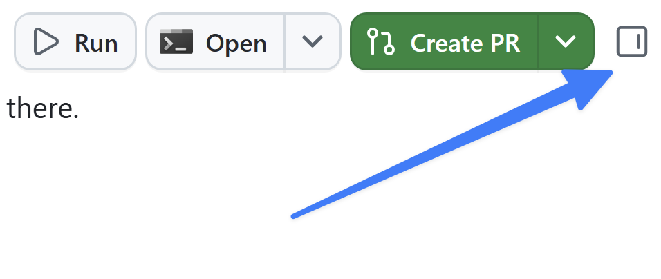

前のレッスンでは、ワークスペースを確認し、クイックチャットを使いました。次は**エージェント セッション**を開始し、プロジェクトに最初の変更を加えます。変更は小さくします。ゲームのデータには星評価がすでにありますが、ホーム ページのゲーム カードには表示されていません。エージェントに表示を依頼し、変更をレビューして、最初のプルリクエストとしてマージします。

このレッスンでは、次の操作を行います。

- エージェント セッションを開始し、セッションの構成を学ぶ。
- エージェントに、小さく範囲を絞った変更を依頼する。
- ワークスペースの差分ビューで変更をレビューする。
- アプリをローカルで実行し、ブラウザーで変更を確認する。
- 最初のプルリクエストを作成してマージする。

## シナリオ

Tailspin Toys の各ゲームには星評価があり、ゲーム詳細ページにはすでに表示されています。しかし、ホーム ページのゲーム カードにはタイトル、カテゴリ、発行元、説明しか表示されていません。準備運動として、各カードに既存の評価を表示するようエージェントに依頼します。最初のセッションにぴったりの、小規模で自己完結した変更です。

## セッションの構造

**セッション**は、専用の分離されたワークスペースで実行されるエージェントとの会話です。各セッションには**専用の Git worktree とブランチ**が割り当てられます。そのため、一方のセッションで機能を追加し、別のセッションでバグを修正するなど、変更を競合させずに複数のセッションを同時に実行できます。セッションはサイドバーでリポジトリごとにまとまっています。選択するとセッションを切り替えられます。

セッションには、エージェントとの**会話**、ファイルを調査・編集するエージェントの**ツール操作**、差分付きの**変更ファイル一覧**が表示されます。

## セッションを開始して変更を依頼する

新しいセッションを開始してプロジェクトを確認し、機能を実装します。[アプリのセットアップ][prior-lesson]では GitHub リポジトリからプロジェクトを追加しました。そのリポジトリ用のセッションを作成し、変更を依頼します。

1. GitHub Copilot app に戻ります (またはアプリを開きます)。
2. サイドバーの上部にある **+** を選択してセッションを開始します。
3. リポジトリとして `tailspin-toys` を選択します。
4. プロンプト ボックスの下で **new working tree** と **Interactive** モードを選択し、次のプロンプトを使って変更を依頼します。

    ```plaintext
    Show each game's starRating out of 5 in the game cards on the list page. If the rating is null, show "No rating yet". Keep the card layout as it is, add tests, and run the relevant checks.
    ```

5. <kbd>Enter</kbd> を押して、プロンプトを Copilot に送信します。

Copilot app は最初にプロジェクトの分離されたコピーである新しい worktree を作成します。次にプロジェクトを調べ、新機能に必要なファイルを探して、コードを作成します。Copilot app を使って新しい機能を追加できました。

## 差分をレビューする

AI が生成した変更は、小さなものでもマージする前にレビューします。Copilot app 内で変更を確認しましょう。

1. アプリの右上にある **Toggle review panel** を選択します。開いたパネルで **Changes** を選び、変更されたファイルとその差分を確認します。

    

2. ゲーム詳細の表示に使う中心的なファイル `GameCard.astro` にコードが追加されていることを確認します。評価があれば表示し、`starRating` が `null` の場合は "No rating yet" に切り替える、次のような小さなブロックです。

   ```astro
   {game.starRating !== null ? (
       <span class="text-xs font-medium px-2.5 py-0.5 rounded bg-amber-900/60 text-amber-300" data-testid="game-rating">
           ★ {game.starRating} / 5
       </span>
   ) : (
       <span class="text-xs font-medium text-slate-500" data-testid="game-rating-empty">
           No rating yet
       </span>
   )}
   ```

> [!NOTE]
> Copilot は、すべての生成 AI ツールと同様に決定論的ではなく確率的に動作するため、実際のコードは上記と異なる場合があります。ただし、比較的よく似たものになります。

## 変更を確認する

ブラウザーを開く前に、エージェントが実行した自動チェックの結果をレビューします。数値の `starRating` と、`null` の場合の表示をテストしていることを確認します。前提条件が不足していたり、チェックがスキップされていたりする場合は成功とはみなしません。インストールの要求は内容を確認してから承認します。

コードを読んだだけで動くと決めつけないようにしましょう。Copilot に Web サイトを起動してもらい、ブラウザー キャンバスで更新された UI を確認します。

> [!TIP]
> キャンバスは、Copilot app 内で使えるインタラクティブなウィジェットです。後のレッスンではカスタム キャンバスを確認し、自分でも作成します。ここでは組み込みのブラウザー キャンバスを使います。

1. 次のプロンプトで、アプリを起動してブラウザー キャンバスで開くよう依頼します。

    ```plaintext
    Start the app and open it in the browser canvas.
    ```

2. しばらくするとアプリが起動し、Copilot app 内にブラウザー ウィンドウが開きます。
3. 評価があるゲーム カードに 5 段階の値が表示されることを確認します。
4. 確認が終わったら、次のプロンプトで、このセッションで起動した開発サーバーを停止するよう依頼します。

    ```plaintext
    Stop the dev server and close the browser canvas.
    ```

## 最初のプルリクエストを作成してマージする

機能を作成できました。次は、新しいコードを既存のコードベースにマージするためのプルリクエスト (PR) を作成します。

1. 右上隅にある **Create PR** を選択します。
2. 求められた場合は **Sign in with your browser** を選択し、画面の指示に従って認証します。
3. リポジトリのポリシーにより PR 作成前に関連する issue が必要だと Copilot が説明した場合は、その手順に従うよう確認します。
4. Copilot が PR を作成します。
5. チャットのすぐ上にある **PR** バブルを選択して、レビューペインで PR を開きます。ここで PR をレビューできます。
6. 準備ができたら **Ready to merge** を選択します。
7. 表示されたダイアログで **Merge pull request** を選択して、PR をマージします。

## まとめと次のステップ

GitHub Copilot app を使って最初の変更をリリースできました。具体的には、次の操作を行いました。

- エージェント セッションを開始し、セッションの構成を学んだ。
- エージェントにゲーム カードの小さく範囲を絞った変更を依頼した。
- ワークスペースの差分ビューで変更をレビューした。
- アプリをローカルで起動し、ブラウザーで星評価を確認した。
- PR 1 を作成し、チェックをレビューして、自分でマージした。

次は[フィルター issue から始め、Plan と Autopilot モードを使って][next-lesson]、より大きな機能を作成します。

## リソース

- [GitHub Copilot app でエージェント セッションを操作する][agent-sessions]
- [GitHub Copilot app について][about-copilot-app]
- [GitHub Copilot app で issue とプルリクエストを管理する][managing-issues-prs]

[prior-lesson]: ../1-install-copilot-app/#github-copilot-app-をインストールして構成する
[next-lesson]: ../3-agent-modes/
[agent-sessions]: https://docs.github.com/copilot/how-tos/github-copilot-app/agent-sessions
[about-copilot-app]: https://docs.github.com/copilot/concepts/agents/github-copilot-app
[managing-issues-prs]: https://docs.github.com/copilot/how-tos/github-copilot-app/managing-issues-and-pull-requests
